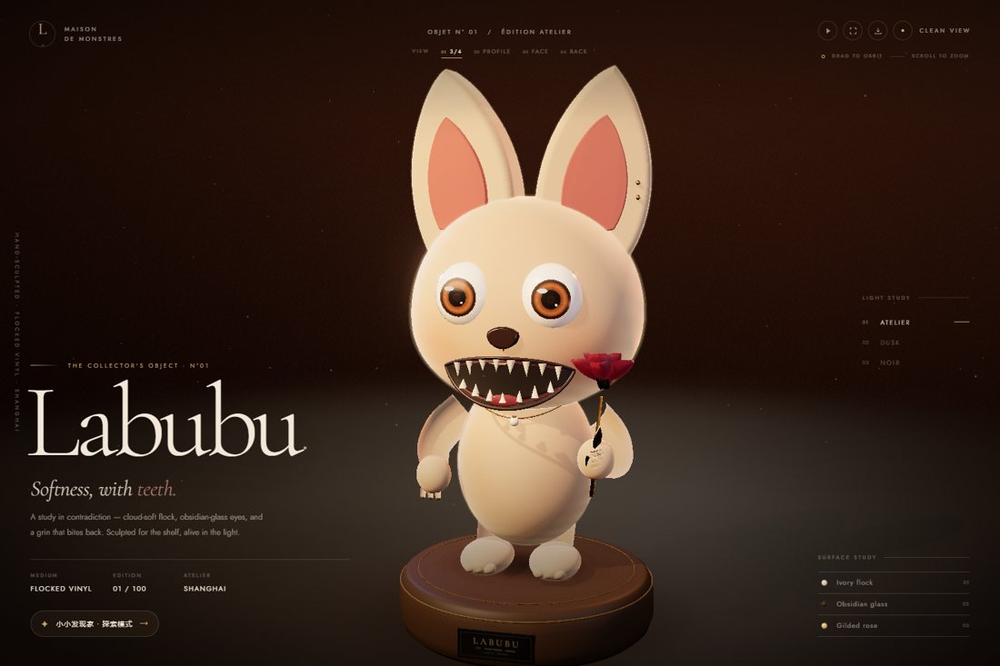
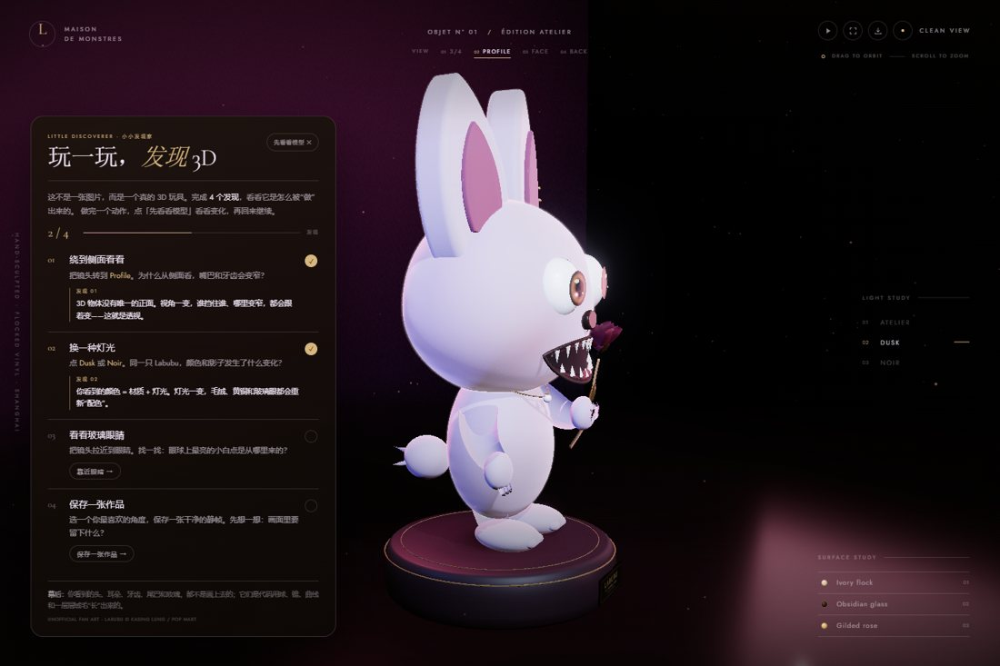

# Peanut's Coding Lesson 🎓

一个为小朋友设计的编程学习项目，包含趣味编程工具、交互式学习程序和一个 3D 艺术展台。

[English Version](README_EN.md)

## 📚 项目内容

这是一系列专为儿童设计的编程学习作品：

### 1. 📐 Logo绘画课程
**文件:** `Peanut's coding lesson.html`

- 学习Logo编程语言的基础
- 通过编写简单命令用海龟绘制图形
- 培养逻辑思维和空间想象力
- 多种主题皮肤可选（暗黑、浅色、海洋、森林、落日、糖果）

### 2. 🎹 打字练习程序
**文件:** `星光琴键：童话魔法乐章.html`

- 通过音乐和故事增强学习趣味
- 打字练习和手指灵活性训练
- 魔幻童话主题的视觉体验
- 渐进式难度设置

### 3. 🧪 小小物理实验室
**文件:** `小小物理实验室.html`

- 单文件离线的 3D（WebGL）互动物理实验台
- 六个实验场景：直线运动与摩擦力、弹簧墙反弹、坡道能量、斜面加速度、自由落体、动量守恒
- 实时 v-t 曲线、实验记录表，可导出 CSV 实验数据
- 「猜一猜 → 做一做 → 想一想」的讲解方式，附名词小词典

### 4. 🗺️ 江山小史官 · 一堂用地图讲的中国历史课
**文件:** `江山小史官：一堂用地图讲的中国历史课.html`

- 单文件离线的 40 分钟历史课，面向 8–12 岁孩子，主线是「何时、何地、何人」三个问题
- 四个互动关卡：时间机器（十八朝时间轴 **+ 每个朝代一张真实疆域图**，拖动即变）、城名侦探（长安→西安、建康→南京、大梁→开封、蓟→北京）、跟着苏东坡搬家（行迹地图 + 诗句 + 里程）、古地名小试（在地图上扎针寻址、按距离评分授官阶）
- **第五关「两千年长卷」**：十八帧疆域图自动播放，带上一帧的朱砂残影对比、缩略图索引，十几秒看完两千四百年的分合
- **可打印 A3 长卷海报**：十八格疆域一览 + 三句话读图提示，适合贴墙或做课堂挂图
- 疆域轮廓由项目的 167 个历史快照抽稀而来（示意），叠加了淡淡的现代省界「透视镜」
- 内置「教师手册」：40 分钟流程表、逐句台词、预设问答、差异化方案、评价量表，可一键打印 / 存 PDF
- 灵感与部分数据来自开源项目 [江山时序](https://github.com/DeanChensj/jiangshan-map)（GPL-3.0）

### 5. 🧸 拉布布 3D 收藏品 · The Soft Monster
**文件:** `拉布布3D：柔软怪物.html`

- 一个完全由代码生成的实时 3D 艺术玩具：没有导入模型，头、耳朵、牙齿、爪子、尾巴、项链和黄铜玫瑰都是程序化雕塑
- 三层质感：绒毛壳层 + 纤维法线、玻璃质琥珀虹膜、珠光牙齿、黄铜与丝绒花瓣
- 单文件离线运行，自带三套画廊灯光：Atelier、Dusk、Noir
- 阅览功能：3/4、Profile、Face、Back 四个镜头研究；点击 Surface study 可飞到绒毛、眼睛或玫瑰近景
- 工具：转盘播放 / 暂停、全屏、导出不含 UI 的干净 PNG；支持键盘方向键、缩放和快捷键
- **小小发现家（新增）**：4 个中文探索任务，带进度、发现卡和「小小发现家」印章；孩子边玩边理解视角、灯光、材质和构图
- 面向 8 岁以上的创意编程 / 3D 图形学赏析；**粉丝向艺术演绎**，Labubu 角色版权归 Kasing Lung / Pop Mart 所有，本项目与官方无关

#### 给 10 岁小朋友：15–20 分钟怎么玩

1. **自由玩 2 分钟**：转一转、放大看看，找出耳朵、牙齿、玫瑰和尾巴。
2. **完成 4 个发现**：点「小小发现家」，跟着任务切换侧脸、灯光、眼睛特写，最后保存一张自己的构图。每个任务约 2–3 分钟。
3. **说一说**：侧面和正面哪里不一样？灯光变了，毛色和影子怎么变？眼睛为什么亮晶晶？你想把哪个角度留下来？

孩子会练到：**空间视角与遮挡、光源与颜色、材质反射、构图表达**，以及“3D 模型不是画出来的，而是由几何体、材质、灯光和相机参数组成的”这一层直觉。  
它不是编程语法课，而是 3D 图形学的“玩中学”入口；适合亲子共玩或课堂暖场，不建议连续玩超过 20 分钟。

## 🚀 快速开始

1. 克隆或下载本仓库
2. 在网页浏览器中打开HTML文件
3. 开始学习编程！

## 📖 如何使用

### Logo绘画课
- 打开 `Peanut's coding lesson.html`
- 在编辑器中输入Logo命令
- 执行代码查看海龟绘制的图形

### 打字练习
- 打开 `星光琴键：童话魔法乐章.html`
- 按照屏幕提示进行打字练习
- 完成挑战获得反馈

### 历史课
- 打开 `江山小史官：一堂用地图讲的中国历史课.html`
- 按底部「下一步」逐关上课；点右上角「家长 / 老师版」打开教案
- 第四关可以直接在地图上点，离得越近分数越高

### 物理实验室
- 打开 `小小物理实验室.html`
- 在「实验控制台」里选场景、调参数（质量、推力、摩擦、角度等）
- 点「推一下 / 释放」，观察小球运动、实时 v-t 曲线和实验记录
- 跟着「实验任务」和「为什么」的提示，自己动手验证结论

### 拉布布 3D 展台
- 打开 `拉布布3D：柔软怪物.html`
- 拖拽旋转、滚轮缩放；顶部可切换 3/4、侧面、正面、背面
- 点击右侧 Surface study 的条目，看绒毛、玻璃眼或玫瑰的近景
- 点「小小发现家」开启 4 个中文探索任务；做完一个动作后点「先看看模型」，看看变化再回来继续
- 按 `T` 开始 / 暂停转盘，按 `S` 保存一张干净的 PNG 静帧，按 `C` 隐藏界面专心欣赏

## 🎨 特色功能

- ✨ 友好的用户界面
- 🎨 多种主题皮肤
- 📱 响应式设计，支持多种设备
- 🌐 中文界面
- 🗺️ 历史与地理：把年份、地名、人物行迹放在同一张地图上
- 🧸 3D 创作：程序化几何、PBR 材质、灯光研究与静帧导出
- 🔎 玩中学：视角、灯光、材质、构图四个中文探索任务
- 🔄 逐步学习曲线

## 📝 计划功能

未来会持续添加更多编程学习工具：

- [ ] 基础数学课程
- [ ] 游戏开发入门
- [ ] 数据可视化
- [ ] 更多互动学习模块

## 👧 学习目标

- 培养孩子的编程思维
- 提升逻辑思维能力
- 增强手眼协调能力
- 激发对STEM的兴趣

## 💝 关于项目

这个项目是为小朋友"Peanut"的编程教育而创建的，通过寓教于乐的方式让孩子学习编程基础概念。

## 📄 许可证

MIT License - 可随意使用和修改

拉布布 3D 页面内嵌 Three.js（MIT）与 Cormorant Garamond / Jost 字体（SIL OFL 1.1）；完整许可见 [THIRD_PARTY_NOTICES.md](THIRD_PARTY_NOTICES.md)。

## 👨‍👧 贡献

欢迎提交建议和改进意见！

---

**开始学习吧！** 🎉
