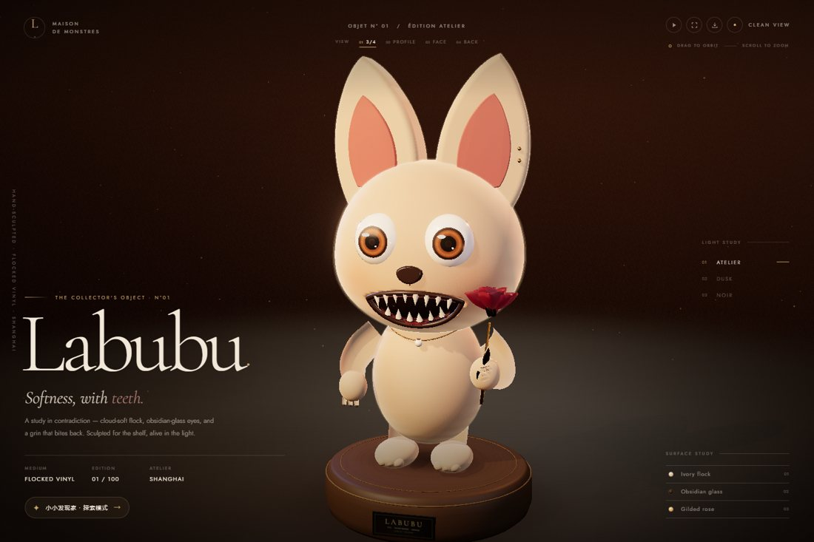
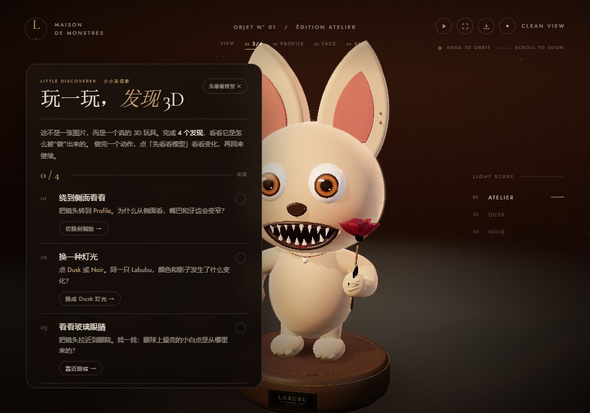
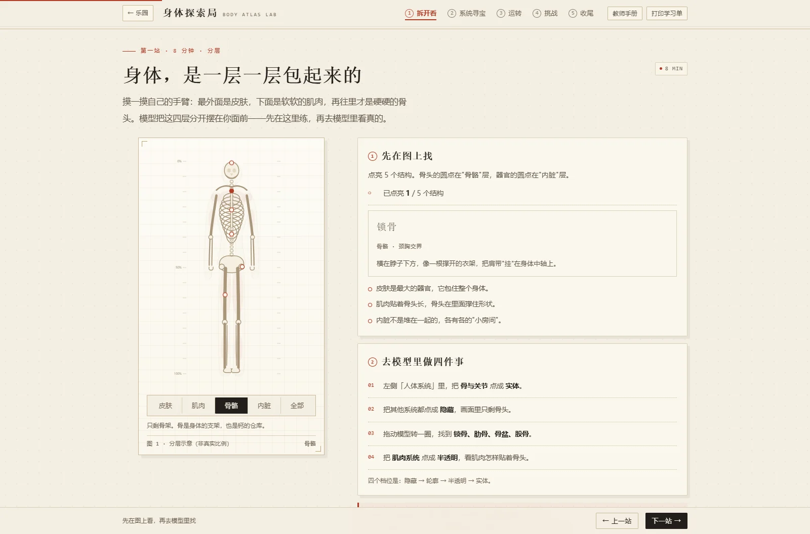

# Peanut's Coding Lesson 🎓

一个为小朋友设计的互动学习项目：**六堂课**——编程、物理、历史地图、3D 艺术、3D 人体；外加一个**奇趣阁**，里面是六件可以在手里玩的小玩具——会动的转筒、霜窗、针幕、陶轮、水拓画和锦鲤池。

**在线打开：<https://peanut-rice.github.io/Peanut-Coding-Lesson/>**（不用装任何东西；想离线用就把仓库下载下来，直接打开 `index.html`）

[English Version](README_EN.md)

## 📚 六堂课

这是一系列专为儿童设计的互动学习作品：

### 1. 📐 Logo绘画课程
**文件:** `Peanut's coding lesson.html`

- 学习Logo编程语言的基础
- 通过编写简单命令用海龟绘制图形
- 培养逻辑思维和空间想象力
- 多种主题皮肤可选（暗黑、浅色、海洋、森林、落日、糖果）

### 2. 🎹 打字练习程序
**文件:** `星光琴键：童话魔法乐章.html`

- 通过音乐和故事增强学习趣味
- 打字练习和手指灵活性训练
- 魔幻童话主题的视觉体验
- 渐进式难度设置

### 3. 🧪 小小物理实验室
**文件:** `小小物理实验室.html`

- 单文件离线的 3D（WebGL）互动物理实验台
- 六个实验场景：直线运动与摩擦力、弹簧墙反弹、坡道能量、斜面加速度、自由落体、动量守恒
- 实时 v-t 曲线、实验记录表，可导出 CSV 实验数据
- 「猜一猜 → 做一做 → 想一想」的讲解方式，附名词小词典

### 4. 🗺️ 江山小史官 · 一堂用地图讲的中国历史课
**文件:** `江山小史官：一堂用地图讲的中国历史课.html`

- 单文件离线的 40 分钟历史课，面向 8–12 岁孩子，主线是「何时、何地、何人」三个问题
- 四个互动关卡：时间机器（十八朝时间轴 **+ 每个朝代一张真实疆域图**，拖动即变）、城名侦探（长安→西安、建康→南京、大梁→开封、蓟→北京）、跟着苏东坡搬家（行迹地图 + 诗句 + 里程）、古地名小试（在地图上扎针寻址、按距离评分授官阶）
- **第五关「两千年长卷」**：十八帧疆域图自动播放，带上一帧的朱砂残影对比、缩略图索引，十几秒看完两千四百年的分合
- **可打印 A3 长卷海报**：十八格疆域一览 + 三句话读图提示，适合贴墙或做课堂挂图
- 疆域轮廓由项目的 167 个历史快照抽稀而来（示意），叠加了淡淡的现代省界「透视镜」
- 内置「教师手册」：40 分钟流程表、逐句台词、预设问答、差异化方案、评价量表，可一键打印 / 存 PDF
- 灵感与部分数据来自开源项目 [江山时序](https://github.com/DeanChensj/jiangshan-map)（GPL-3.0）

### 5. 🧸 拉布布 3D 收藏品 · The Soft Monster
**文件:** `拉布布3D：柔软怪物.html`

- 一个完全由代码生成的实时 3D 艺术玩具：没有导入模型，头、耳朵、牙齿、爪子、尾巴、项链和黄铜玫瑰都是程序化雕塑
- 三层质感：绒毛壳层 + 纤维法线、玻璃质琥珀虹膜、珠光牙齿、黄铜与丝绒花瓣
- 单文件离线运行，自带三套画廊灯光：Atelier、Dusk、Noir
- 阅览功能：3/4、Profile、Face、Back 四个镜头研究；点击 Surface study 可飞到绒毛、眼睛或玫瑰近景
- 工具：转盘播放 / 暂停、全屏、导出不含 UI 的干净 PNG；支持键盘方向键、缩放和快捷键
- **小小发现家（新增）**：4 个中文探索任务，带进度、发现卡和「小小发现家」印章；孩子边玩边理解视角、灯光、材质和构图
- 面向 8 岁以上的创意编程 / 3D 图形学赏析；**粉丝向艺术演绎**，Labubu 角色版权归 Kasing Lung / Pop Mart 所有，本项目与官方无关

#### 给 10 岁小朋友：15–20 分钟怎么玩

1. **自由玩 2 分钟**：转一转、放大看看，找出耳朵、牙齿、玫瑰和尾巴。
2. **完成 4 个发现**：点「小小发现家」，跟着任务切换侧脸、灯光、眼睛特写，最后保存一张自己的构图。每个任务约 2–3 分钟。
3. **说一说**：侧面和正面哪里不一样？灯光变了，毛色和影子怎么变？眼睛为什么亮晶晶？你想把哪个角度留下来？

孩子会练到：**空间视角与遮挡、光源与颜色、材质反射、构图表达**，以及“3D 模型不是画出来的，而是由几何体、材质、灯光和相机参数组成的”这一层直觉。  
它不是编程语法课，而是 3D 图形学的“玩中学”入口；适合亲子共玩或课堂暖场，不建议连续玩超过 20 分钟。

### 6. 🫀 身体探索局 · 一堂用 3D 解剖讲的人体课
**文件:** `身体探索局：一堂用 3D 解剖讲的人体课.html`

- 单文件课程页，45 分钟，面向 9–12 岁；配合开源 3D 人体平台 [BodyVista](https://github.com/FreedomIntelligence/BodyVista)（在线演示：[freedomintelligence.github.io/BodyVista](https://freedomintelligence.github.io/BodyVista/)）使用
- 五站推进：**拆开看**（分层透视台：皮肤 / 肌肉 / 骨骼 / 内脏四层 + 14 个可点结构）、**系统寻宝**（6 对器官—系统配对 + 4 行寻宝表）、**运转**（心跳三拍动画 + 肺泡气体交换）、**挑战**（6 题带解析，衔接模型里的 5 题「解剖挑战」）、**收尾**（一句话解剖 + 3–2–1 出门条）
- 教师手册内置：45 分钟流程表、逐站台词与关键提问、BodyVista 操作卡（隐藏 / 轮廓 / 半透明 / 实体、生命律动、微观探索、解剖挑战、剖切）、预设问答、30 分钟版与无网方案、评价量表、边界与伦理提醒；可一键打印 / 存 PDF
- 学习单可打印（含「画一画」），页面内的点亮记录、配对、寻宝、成绩与出门条保存在浏览器本地，不上传
- 插图全部为内联 SVG（分层人体、心脏、肺泡），不依赖外部图片，也不内嵌 BodyVista 的模型素材；模型与内容版权归原项目及数据方
- 已附打印件：`教师手册·身体探索局.pdf`、`学习单·身体探索局.pdf`
- 版权说明：本项目**不打包** BodyVista 的模型或页面，只链接其官方站点；课程插图与文字为原创，结构名称等事实性内容仅作教学引用。BodyVista 代码为 MIT，但解剖模型属于 Z-Anatomy / BodyParts3D 等第三方资源，上游标注了 `NC exceptions; research only` 等限制，公开再分发前需自行核对授权

## 🎪 奇趣阁 · 六件小玩具

乐园是上课的地方，奇趣阁是玩的地方。六件单文件小玩具，没有分数、没有输赢；每一件都有「四件小事」，还有一段讲给孩子听的「为什么」。

### 1. 🎠 会动的转筒 · 一台会跑的小画片机
**文件:** `会动的转筒：小小动画机.html`

- 单文件离线的「西洋镜」（Zoetrope）玩具：木筒里贴着 12 张只差一点点的小画，转起来就能从缝里看见小马在跑
- 8 个可以换的动画条：小马跑步、杂技小丑、青蛙跳圈、小燕子、跳舞娃娃、皮球和星星，还有小朋友最爱的**小汽车**和**小火箭**
- 四种转法：按「转起来」、点「慢 / 刚好 / 快」三档对照、用手指拨筒子、抓住右边的小铜摇柄摇一摇；「按住停住」是刹车
- 屏幕上直接读「每秒几张画」：12 格 × 每秒转几圈 = 每秒 1…41 张，孩子可以自己算出「要转多快才不糊」
- 给孩子看的「为什么」：掀开盖子，缝隙跟着盖子走开，就只剩下 12 张不会动的画——一眼看懂「动画是静止的图画连起来的」
- **自己画一部小电影**：12 格画板（上一格的淡影子照着改）、5 种颜色、3 种粗细、橡皮、撤销、清空本格、「照抄上一格」、**放大画一格**、实时小预览，**自动保存在本机**，画完「送进转筒」自动转起来
- **拿得出手**：「首映」全屏模式（藏起按钮、加片名卡）、**存成动图（GIF）**、存成 12 格长图，都是单文件离线生成，不联网
- **四件小事**打卡：找到「刚好」、掀开盖子数一数、12 格都画上东西、第 12 格接回第 1 格
- 界面全中文、大按钮、明亮配色，手机竖屏可用

### 2. ❄️ 霜窗 · 哈一口气的玻璃
**文件:** `霜窗：哈一口气的玻璃.html`

- 单文件离线的一扇夜窗：霜花沿着窗框和玻璃上的划痕一根根长出来，六角的小霜花慢慢开，窗外街灯糊成一团团暖光
- 按住玻璃就是「哈一口气」：雾从手指边散开，霜化成水珠，偶尔有一颗变重、往下爬出一道透明的痕
- 松开手，霜会从旁边慢慢长回来，每次的花纹都不一样——在雾上写的名字，就是这么被一点一点盖住的
- 左下角有一支温度计（外面 −11℃、屋里 14℃）；点一下看读数
- 「四件小事」：哈出一块透明的窗 / 在雾上写一个字 / 等霜重新长回来 / 看一颗水珠往下爬
- 没有分数、没有时间，安静，适合睡前；手机竖屏可用

### 3. 🪡 针幕 · 一板会记住手印的针
**文件:** `针幕：一板会记住手印的针.html`

- 单文件离线的针幕（pin art / pin screen）玩具：一板密密麻麻的钢针，推上去就亮，退回来就暗，顶光一斜，钢针会闪
- 用手指按下去、拖过去，针凹下去一块；松手后针会慢慢弹回来，手印像雪一样一点点化掉
- 「印手」按出一个手印；「按个字」按出「花生 / 你好 / 王 / 哈哈」；「翻板」让整板针「哗」地落回去
- 「四件小事」；触摸屏效果最好，桌面也顺手

### 4. 🏺 陶轮 · 一团会塌的泥
**文件:** `陶轮：一团会塌的泥.html`

- 单文件离线的拉坯玩具：一团湿泥在转盘上，踩下踏板转起来，用手指把泥往上拉、往里推、把口撑开
- 转太快、壁太薄，罐子会晃、会塌——塌了不是失败，点「再团一团」就好，还会笑着记一笔「塌了几次」
- 拉好了选釉色（青瓷 / 天目 / 钴蓝 / 米白），进窑烧一烧；成品站上架子，每一只都有编号，存在本机
- 四步走：拉坯 → 上釉 → 进窑 → 上架；「四件小事」；屏幕大一点更好玩，手机竖屏也能拉

### 5. 🌊 水拓画 · 水上的花纹
**文件:** `水拓画：水上的花纹.html`

- 单文件离线的水拓画（suminagashi）玩具：墨浮在水上，一滴推着一滴，变成一圈圈套着的花纹
- 用梳子拖一下，拉出羽毛；用扇子点一下，整盘水转一圈；蓝、红、青、黄和「清水」（能开出白洞）五种墨
- 盖一张纸、拉起来——花纹就印在纸上（印出来是反的，和真的一样），挂在晾架上；再滴墨，可以连着拉七八张
- 印好的画存在本机，点开能看大图；「四件小事」；手机竖屏可用，手指就是梳子

### 6. 🐟 锦鲤池 · 养一池鱼
**文件:** `锦鲤池：养一池鱼.html`

- 单文件离线的一池正午锦鲤：鱼是一条条脊椎带着游的，胸鳍在划、尾巴在扇；水底有光斑，水面有睡莲和落叶
- 敲一下水面，波纹散开，附近的鱼会躲一下再回来；按住水面（或按「喂一把」）撒鱼食，鱼会围过来抢
- 手指贴着水面慢慢移，好奇的那条会跟着你；点一下鱼背，它会告诉你自己叫什么（红白 / 昭和 / 黄金 / 丹顶）
- 没有目标、没有分数，当宠物养；「四件小事」；手机竖屏最好看

## 🚀 快速开始

1. 克隆或下载本仓库
2. 用浏览器打开 `index.html`：**六堂课**都在这里
3. 想玩的时候，点标题下面那扇**奇趣阁**的门；玩具页左上角「← 奇趣阁」回阁，阁里「← 乐园」回首页

## 📖 如何使用

### Logo绘画课
- 打开 `Peanut's coding lesson.html`
- 在编辑器中输入Logo命令
- 执行代码查看海龟绘制的图形

### 打字练习
- 打开 `星光琴键：童话魔法乐章.html`
- 按照屏幕提示进行打字练习
- 完成挑战获得反馈

### 历史课
- 打开 `江山小史官：一堂用地图讲的中国历史课.html`
- 按底部「下一步」逐关上课；点右上角「家长 / 老师版」打开教案
- 第四关可以直接在地图上点，离得越近分数越高

### 物理实验室
- 打开 `小小物理实验室.html`
- 在「实验控制台」里选场景、调参数（质量、推力、摩擦、角度等）
- 点「推一下 / 释放」，观察小球运动、实时 v-t 曲线和实验记录
- 跟着「实验任务」和「为什么」的提示，自己动手验证结论

### 拉布布 3D 展台
- 打开 `拉布布3D：柔软怪物.html`
- 拖拽旋转、滚轮缩放；顶部可切换 3/4、侧面、正面、背面
- 点击右侧 Surface study 的条目，看绒毛、玻璃眼或玫瑰的近景
- 点「小小发现家」开启 4 个中文探索任务；做完一个动作后点「先看看模型」，看看变化再回来继续
- 按 `T` 开始 / 暂停转盘，按 `S` 保存一张干净的 PNG 静帧，按 `C` 隐藏界面专心欣赏

### 身体探索局
- 打开 `身体探索局：一堂用 3D 解剖讲的人体课.html`，点「开始第一站」
- 需要 3D 模型时点「打开 BodyVista」；课前先打开一次，让浏览器缓存好
- 点右上「教师手册」看教案；「打印学习单」可直接打印或存 PDF
- 页面记录存在这台电脑的浏览器里，换设备不会同步

### 会动的转筒
- 打开 `会动的转筒：小小动画机.html`
- 先点一个动画，再按「转起来」，然后盯着筒上的小缝看；也可以点「慢 / 刚好 / 快」三档比一比，看左上角「每秒几张画」怎么变
- 点「掀开盖子」看筒里的 12 张画；点「一格一格看」一张一张翻
- 点底部「我要画自己的小电影」：12 格画板，每格只改一点点，按「送进转筒」看自己的动画；画会自动存在这台电脑上，关掉再打开还在
- 画好了点「▶ 首映」全屏放给家人看，或者「存成动图」发出去；下面的「四件小事」可以打卡

### 奇趣阁（六件小玩具：转筒 / 霜窗 / 针幕 / 陶轮 / 水拓画 / 锦鲤池）
- 从首页标题下面的门进 `奇趣阁：六件小玩具.html`；玩具页左上角「← 奇趣阁」回阁。每一件都有「四件小事」可以慢慢发现
- **霜窗**：按住玻璃哈气、在雾上写字；点右下角「重新结霜」换一扇新玻璃
- **针幕**：手指按；「印手」按手印，「按个字」按出一个词，「翻板」让针全落回去
- **陶轮**：按住「转起来」或踩踏板，再在泥上拖；塌了点「再团一团」；拉好了选釉、进窑
- **水拓画**：先滴墨，再用梳子拖、用扇子搅，最后「拉一张纸」；晾架里能看大图
- **锦鲤池**：敲水面、按住撒鱼食、手指慢慢移；点鱼背看名字
- **会动的转筒**：见上一节

## 🎨 特色功能

- ✨ 友好的用户界面
- 🎨 多种主题皮肤
- 📱 响应式设计，支持多种设备
- 🌐 中文界面
- 🗺️ 历史与地理：把年份、地名、人物行迹放在同一张地图上
- 🧸 3D 创作：程序化几何、PBR 材质、灯光研究与静帧导出
- 🔎 玩中学：视角、灯光、材质、构图四个中文探索任务
- 🔄 逐步学习曲线
- 🖐️ 指尖玩具：六件没有分数的小玩具，靠手感和「再来一次」留住孩子
- 🔬 每件玩具都有一句「为什么」：霜怎么长、针怎么弹、泥怎么塌、墨怎么浮、鱼为什么跟着手

## 📝 计划功能

未来会持续添加更多编程学习工具：

- [ ] 基础数学课程
- [ ] 游戏开发入门
- [ ] 数据可视化
- [ ] 更多互动学习模块

## 👧 学习目标

- 培养孩子的编程思维
- 提升逻辑思维能力
- 增强手眼协调能力
- 激发对STEM的兴趣

## 💝 关于项目

这个项目是为小朋友"Peanut"的编程教育而创建的，通过寓教于乐的方式让孩子学习编程基础概念。

## 📄 许可证

MIT License - 可随意使用和修改

拉布布 3D 页面内嵌 Three.js（MIT）与 Cormorant Garamond / Jost 字体（SIL OFL 1.1）；完整许可见 [THIRD_PARTY_NOTICES.md](THIRD_PARTY_NOTICES.md)。

## 👨‍👧 贡献

欢迎提交建议和改进意见！

---

**开始学习吧！** 🎉
