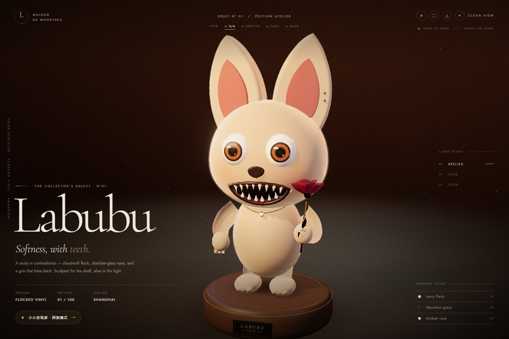
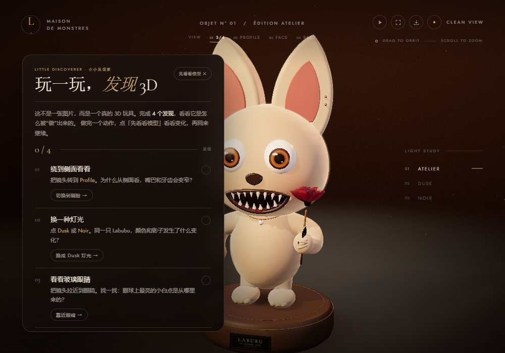
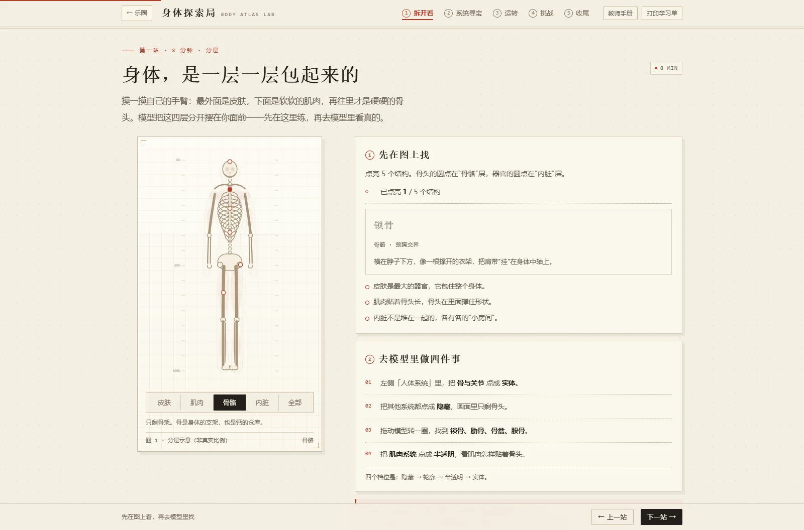

# Peanut's Coding Lesson 🎓

A coding-learning project for children: **six lessons** — programming, physics, history on the map, a 3D art toy, a 3D anatomy lesson — plus **the Cabinet**, six small things to play with by hand: a zoetrope, a frosted window, a pin screen, a pottery wheel, a marbling tray and a koi pond.

**Open it online: <https://peanut-rice.github.io/Peanut-Coding-Lesson/>** — nothing to install. For offline use, download the repo and open `index.html`.

[中文版](README.md)

## 📚 Six Lessons

A set of child-friendly coding learning projects.

### 1. 📐 Logo Drawing Course
**File:** `Peanut's coding lesson.html`

- Learn the basics of the Logo programming language
- Use simple commands to draw with the turtle graphics
- Build logical thinking and spatial imagination
- Multiple theme skins available (Dark, Light, Ocean, Forest, Sunset, Candy)

### 2. 🎹 Typing Practice Program
**File:** `星光琴键：童话魔法乐章.html`

- Enhance learning with music and storytelling
- Typing exercises to improve finger dexterity
- Fairy-tale themed visual experience
- Progressive difficulty levels

### 3. 🧪 Little Physics Lab
**File:** `小小物理实验室.html`

- A single-file, offline 3D (WebGL) interactive physics lab
- Six experiment scenes: straight-line motion & friction, spring-wall bounce, ramp energy, incline acceleration, free fall, momentum conservation
- Real-time v-t chart, experiment log table, and CSV export of results
- A "guess → try → think" explanation flow, plus a glossary of physics terms

### 4. 🗺️ Little Historian · A Map-Based Chinese History Class
**File:** `江山小史官：一堂用地图讲的中国历史课.html`

- A single-file, offline 40-minute history lesson for ages 8–12, built around three questions: when, where, who
- Four interactive stations: a draggable timeline of 18 eras **with a real territory map for each dynasty**, a "city name detective" game (Chang'an → Xi'an, Jiankang → Nanjing, Daliang → Kaifeng, Ji → Beijing), Su Shi's exile route with poems and cumulative distance, and a locate-the-ancient-place map quiz scored by distance
- A fifth station, **"Two Thousand Years"**, plays the 18 territory maps as a 13-second timelapse with a ghost outline of the previous frame
- **Printable A3 poster**: all 18 maps on one sheet, with a three-line reading guide
- Includes a printable teacher's guide: 40-minute run sheet, line-by-line script, anticipated questions, differentiation, and an assessment rubric
- Inspired by the open-source [Jiangshan Atlas](https://github.com/DeanChensj/jiangshan-map) (GPL-3.0); some data derived from it

### 5. 🧸 Labubu 3D Art Toy · The Soft Monster
**File:** `拉布布3D：柔软怪物.html`

- A fully procedural, real-time 3D art toy: the head, ears, fangs, paws, tail, necklace and gilded rose are all built in code, with no imported model
- Layered materials: flocked fur shells with fibre normals, glassy amber eyes, pearl teeth, brass and rose-velvet petals
- Single-file and offline, with three gallery lighting studies: Atelier, Dusk and Noir
- Viewing tools: 3/4, Profile, Face and Back camera studies; click a Surface study row to fly to the fur, eyes or rose
- Turntable play/pause, fullscreen, clean PNG export without the UI, and keyboard orbit/zoom shortcuts
- **Little Discoverer (new)**: four Chinese-language discovery missions with progress, fact cards and a stamp, introducing viewpoint, lighting, materials and composition through play
- A creative-coding / 3D graphics showcase for ages 8+; **unofficial fan art**. Labubu is a character by Kasing Lung / Pop Mart; this project is not affiliated with the rights holders.

#### For a 10-year-old: a 15–20 minute play

1. **Free play (2 min)**: rotate, zoom, and find the ears, fangs, rose and tail.
2. **Four discoveries (about 12 min)**: open "Little Discoverer", switch to Profile, change the light, look closely at the eyes, and save a composition of your own.
3. **Talk about it**: What changes between the front and the side? How do the fur and shadows change with the light? Why are the eyes shiny? Which view would you keep?

The child practises **spatial viewpoint and occlusion, light and colour, surface reflection, and composition**, plus the intuition that a 3D model is assembled from geometry, materials, lights and camera parameters—not simply drawn.  
It is not a syntax lesson; it is a playful entry point to 3D graphics, best used as a parent–child activity or a classroom warm-up, for no more than about 20 minutes.

### 6. 🫀 Body Atlas Lab · A 3D Anatomy Lesson
**File:** `身体探索局：一堂用 3D 解剖讲的人体课.html`

- A single-file, 45-minute lesson for ages 9–12, designed to be used alongside the open-source 3D anatomy platform [BodyVista](https://github.com/FreedomIntelligence/BodyVista) ([live demo](https://freedomintelligence.github.io/BodyVista/))
- Five stations: **Peel it open** (a layered x-ray table — skin / muscle / bone / organs, with 14 clickable structures), **System hunt** (six organ–system pairs plus a four-row hunt sheet), **How it runs** (a three-beat heart animation and alveolar gas exchange), **Challenge** (six questions with explanations, bridging to the five "Anatomy Challenge" questions in the model), and **Wrap-up** (a one-sentence anatomy plus a 3–2–1 exit ticket)
- Teacher's guide built in: 45-minute run sheet, station-by-station script and key questions, a BodyVista operation card (hide / outline / translucent / solid, life rhythm, micro exploration, anatomy challenge, clipping), anticipated questions, a 30-minute version and a no-network plan, an assessment rubric, and notes on boundaries and ethics; printable / saveable as PDF
- A printable worksheet (with a "draw it" section); lighting progress, matching, the hunt, quiz scores and the exit ticket are stored in the local browser and never uploaded
- All illustrations are inline SVG (layered body, heart, alveoli); no external images and no BodyVista model assets are bundled; models and content remain the property of their respective projects
- Includes ready-made print files: `教师手册·身体探索局.pdf` and `学习单·身体探索局.pdf`
- Licensing note: this project **does not bundle** BodyVista's models or pages, it only links to the official site; the course illustrations and text are original, and anatomical structure names are cited as factual teaching content. BodyVista's code is MIT, but the anatomical models come from third-party sources such as Z-Anatomy / BodyParts3D, which upstream marks with restrictions such as `NC exceptions; research only` — check the licences before redistributing

## 🎪 The Cabinet · Six Little Toys

The atelier is where you take a lesson; the Cabinet is where you play. Six single-file toys, no scores and no winning; each one has four small missions and a "why" written for kids.

### 1. 🎠 The Living Zoetrope · A Little Picture Machine
**File:** `会动的转筒：小小动画机.html`

- A single-file, offline zoetrope toy: twelve drawings that differ only slightly are pasted inside a wooden drum — spin it and a horse starts running through the slits
- Eight switchable strips: galloping horse, juggler, frog &amp; hoop, swallow, waltzing couple, ball &amp; star, plus a **car** and a **rocket**
- Four ways to spin: the big 「转起来」 button, the three 「慢 / 刚好 / 快」 (slow / just right / fast) presets, flicking the drum with a finger, or winding the little brass crank; 「按住停住」 is the brake
- A live 「pictures per second」 readout: 12 frames × revolutions per second, so a child can work out how fast it has to spin before it stops looking jerky
- The "why" for kids: lift the lid and the slits leave with it, leaving twelve perfectly still drawings — animation is only still pictures in a row
- **Draw your own movie**: a 12-frame board with an onion-skin ghost of the previous frame, 5 colours, 3 brush sizes, an eraser, undo, clear frame, 「照抄上一格」 (copy the previous frame), a **zoomed frame editor**, a live preview, and **autosave to this device**; 「送进转筒」 drops it into the drum and starts the spin
- **Show it off**: a full-screen 「首映」 (premiere) mode with a title card, **GIF export** and a 12-frame contact sheet — all generated offline in the single file
- **Four small missions** to tick off: find "just right", lift the lid and count, fill all 12 frames, and join frame 12 back to frame 1
- Fully Chinese interface, big buttons, bright colours, works on a phone in portrait

### 2. ❄️ Frost on the Window
**File:** `霜窗：哈一口气的玻璃.html`

- A single-file, offline night window: frost grows tip by tip along the frame and the scratches in the glass, six-armed flowers open, the street lamps outside melt into soft bokeh
- Press and hold the glass to breathe on it: a patch of fog blooms, the frost turns to water, and now and then a heavy bead runs down leaving a clear track
- Let go and the frost creeps back in from the rim with new patterns — which is exactly how a name written in the fog gets covered up again
- A thermometer on the left stile (−11 °C outside, 14 °C inside); tap it for the reading
- **Four small missions**: breathe a clear patch / write one character in the fog / watch the frost grow back / watch a bead run down
- No score, no timer, quiet enough for bedtime; works in phone portrait

### 3. 🪡 The Pin Screen
**File:** `针幕：一板会记住手印的针.html`

- A single-file, offline pin-art toy: a dense field of steel pins that light up when pushed and fall dark when they retreat; a raking light makes the heads glint
- Press and drag to push pins in; when the finger leaves, the pins creep back and the imprint melts like snow
- 「印手」 presses a whole handprint; 「按个字」 presses a word (花生 / 你好 / 王 / 哈哈); 「翻板」 drops the whole board back with a rolling wave
- **Four small missions**; best on a touchscreen, fine with a mouse

### 4. 🏺 The Wheel · Throw a Pot
**File:** `陶轮：一团会塌的泥.html`

- A single-file, offline pottery wheel: a lump of wet clay spins on the head; press the pedal to spin, then pull the clay up, push it in, open the mouth with a finger
- Spin too fast or pull the wall too thin and the pot wobbles and slumps — that is not a failure, tap 「再团一团」 and it also keeps a cheerful 「塌了几次」 tally
- Choose a glaze (celadon / tenmoku / cobalt / oatmeal), fire it in the kiln; the finished pot lands on the shelf with a number, saved on this device
- Four steps: throw → glaze → fire → shelf; **four small missions**; better on a big screen, still throwable in phone portrait

### 5. 🌊 Suminagashi · The Marbling Tray
**File:** `水拓画：水上的花纹.html`

- A single-file, offline marbling tray: ink floats on the water, each drop pushes the rings before it into nested, squeezed bands
- Drag the comb to pull feathers; tap the fan to set the whole tray turning; five inks — indigo, red, teal, yellow and clear water (which opens white holes)
- Lay a sheet, lift it, and the pattern is printed (mirrored, as a real print is) and hung on the drying rack; re-ink and pull another — seven or eight in a row is normal
- Prints persist in the browser; tap one to see it large; **four small missions**; in phone portrait your finger is the comb

### 6. 🐟 Koi Pond, Noon
**File:** `锦鲤池：养一池鱼.html`

- A single-file, offline noon koi pond: each fish swims on a segmented spine, pectoral fins paddling and tail fanning; caustics on the floor, lily pads and fallen leaves on the surface
- Tap the water for ripples — nearby fish dart away and drift back; press and hold (or tap 「喂一把」) to scatter food and the whole pond converges into a jostling knot
- Move a finger slowly across the surface and the nearest curious fish follows it; tap a fish to hear its variety (kohaku / showa / ogon / tancho)
- No goal, no score — keep it as a pet; **four small missions**; best in phone portrait

## 🚀 Quick Start

1. Clone or download this repository
2. Open `index.html` — the **six lessons** are listed there
3. To play, take the **Cabinet** door under the title; inside, every toy links back with 「← 奇趣阁」, and the Cabinet links back to the atelier with 「← 乐园」

## 📖 How to Use

### Logo Drawing
- Open `Peanut's coding lesson.html`
- Enter Logo commands in the editor
- Run the code to see the turtle draw graphics

### Typing Practice
- Open `星光琴键：童话魔法乐章.html`
- Follow on-screen prompts to practice typing
- Complete challenges to receive feedback

### History Class
- Open `江山小史官：一堂用地图讲的中国历史课.html`
- Walk through the stations with the "next" button; open the teacher's guide from the top-right button
- In the fourth station, click anywhere on the map — the closer you are, the higher the score

### Physics Lab
- Open `小小物理实验室.html`
- Pick a scene and tune the parameters (mass, push force, friction, angle, ...) in the Control Panel
- Hit "push / release" and watch the ball, the live v-t chart, and the experiment log
- Follow the task and "why" prompts to verify the conclusions yourself

### Labubu 3D Gallery
- Open `拉布布3D：柔软怪物.html`
- Drag to orbit and scroll to zoom; use the top bar for 3/4, Profile, Face and Back views
- Click a row in Surface study to fly to the flock, the glass eyes or the gilded rose
- Open "Little Discoverer" for four Chinese-language missions; tap "先看看模型" to step back, inspect the change, then return
- Press `T` for the turntable, `S` to save a clean PNG still, and `C` to hide the interface

### Living Zoetrope
- Open `会动的转筒：小小动画机.html`
- Pick a strip, press 「转起来」, then watch the slits on the drum (too blurry? slower; too stuttery? faster)
- 「掀开盖子」 shows the twelve drawings inside; 「一格一格看」 steps through them one at a time
- Tap 「我要画自己的小电影」 at the bottom for the 12-frame board — change each frame just a little, then 「送进转筒」 to watch your own animation

### Body Atlas Lab
- Open `身体探索局：一堂用 3D 解剖讲的人体课.html` and click "开始第一站"
- Click "打开 BodyVista" when you need the 3D model; open it once before class so the browser can cache it
- Click "教师手册" in the top-right for the teacher's guide; "打印学习单" prints the worksheet or saves it as PDF
- Progress is stored in this computer's browser and does not sync across devices

### The Cabinet (six little toys: zoetrope / frost window / pin screen / wheel / marbling / koi)
- Enter from the Cabinet door on the home page (`奇趣阁：六件小玩具.html`); 「← 奇趣阁」 at the top-left of each toy goes back to the Cabinet. Each toy has a 「四件小事」 list to discover
- **Frost window**: press and hold to breathe, write in the fog; 「重新结霜」 gives you a fresh pane
- **Pin screen**: push with a finger; 「印手」 for a handprint, 「按个字」 for a word, 「翻板」 to drop the board
- **Wheel**: hold 「转起来」 (or the pedal), then drag on the clay; if it slumps, tap 「再团一团」, then glaze and fire
- **Marbling**: drop ink, drag the comb, stir with the fan, then 「拉一张纸」; tap a print on the rack to see it large
- **Koi pond**: tap the water, hold to feed, move a finger slowly; tap a fish for its name
- **Zoetrope**: see the section above

## 🎨 Features

- ✨ Friendly user interface
- 🎨 Multiple theme skins
- 📱 Responsive design for multiple devices
- 🌐 Chinese language interface
- 🧸 3D creation: procedural geometry, PBR materials, lighting studies and still export
- 🔎 Learning through play: four Chinese discovery missions on viewpoint, lighting, materials and composition
- 🫀 Layered anatomy with a five-station lesson, teacher's guide and printable worksheet
- 🔄 Gradual learning curve
- 🖐️ Hand-first toys: six things with no score that hold a child by feel and by "one more time"
- 🔬 Every toy answers one "why": why frost grows, why pins spring back, why clay slumps, why ink floats, why a fish follows your finger

## 📝 Planned Features

Future additions will include:

- [ ] Basic math lessons
- [ ] Intro to game development
- [ ] Data visualization
- [ ] More interactive learning modules

## 👧 Learning Goals

- Foster computational thinking in children
- Improve logical reasoning skills
- Enhance hand-eye coordination
- Spark interest in STEM

## 💝 About

This project was created for Peanut's coding education, teaching basic programming concepts through playful and engaging exercises.

## 📄 License

MIT License — free to use and modify.

The Labubu 3D page embeds Three.js (MIT) and the Cormorant Garamond / Jost typefaces (SIL OFL 1.1). See [THIRD_PARTY_NOTICES.md](THIRD_PARTY_NOTICES.md) for the full notices.

## 👨‍👧 Contributing

Contributions and suggestions are welcome!

---

**Let's start learning!** 🎉
